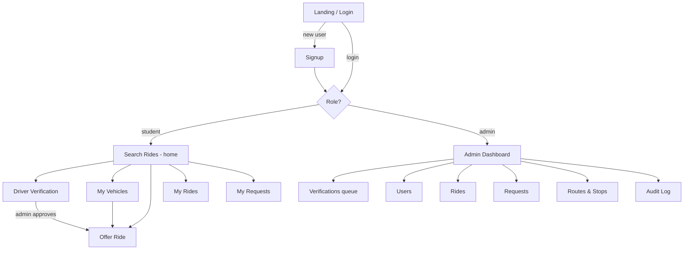
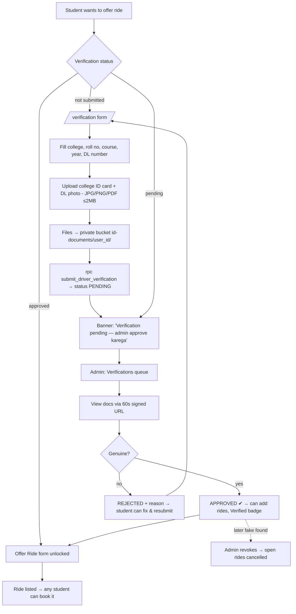
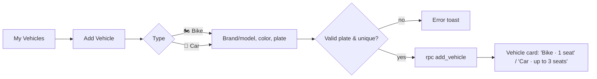
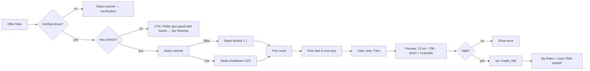
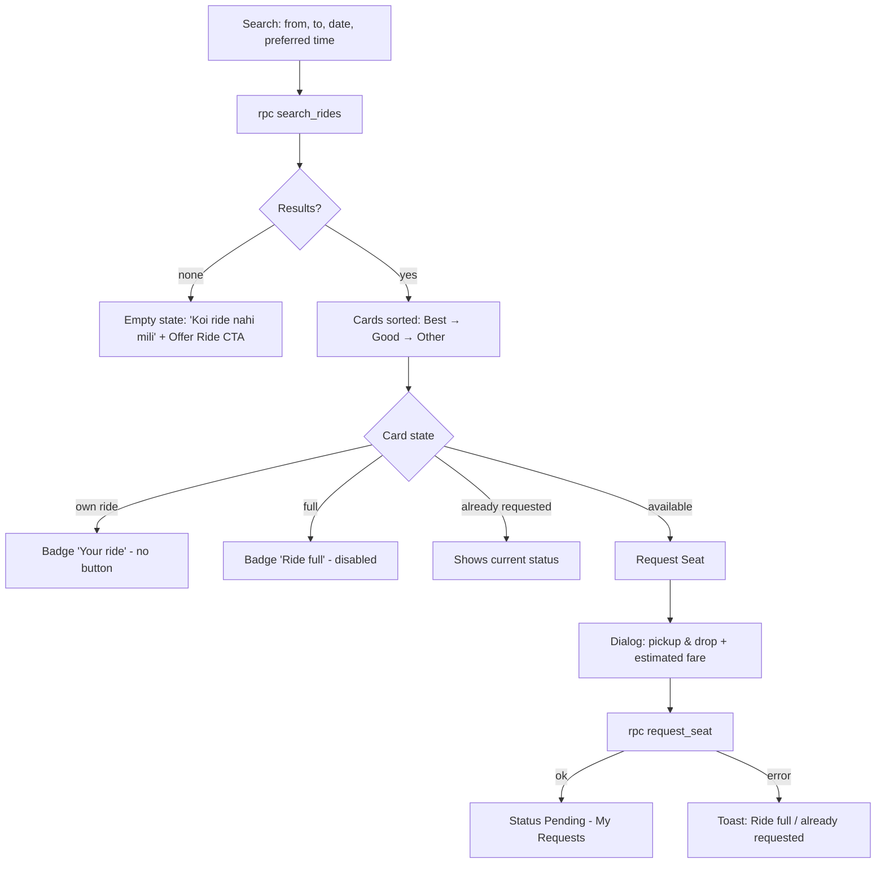
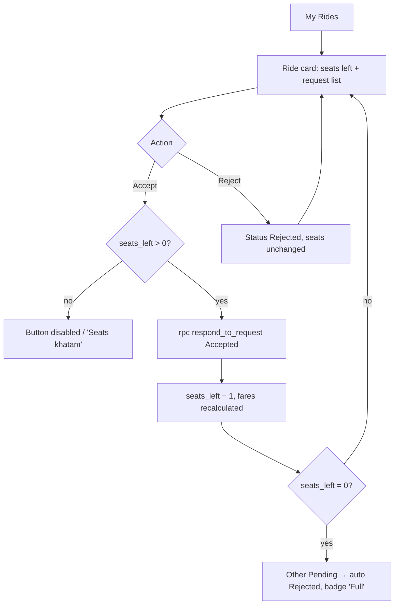
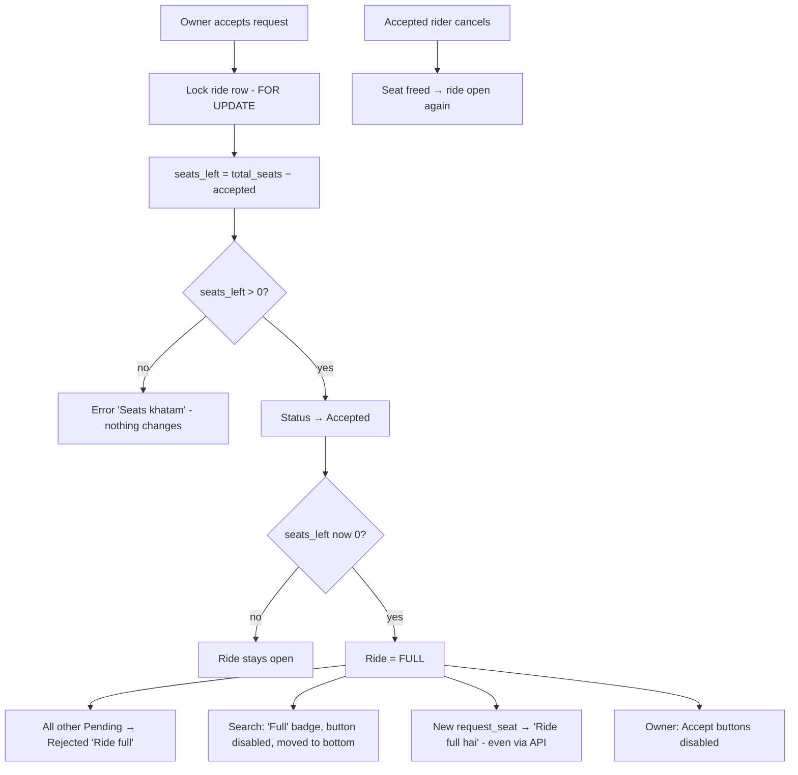
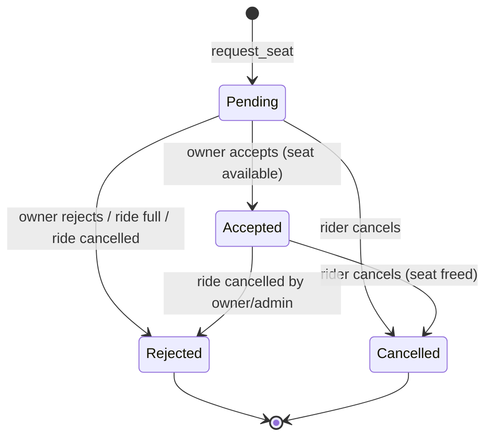
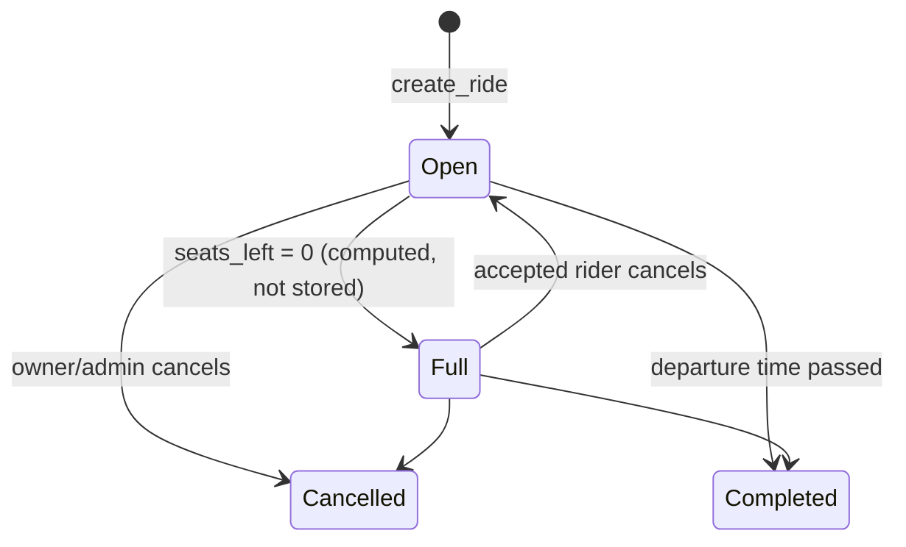

# USER_FLOW.md — User Journeys & Flows

Roles: **Student** (one account = Ride Owner + Rider) · **Admin**.
Screens: `/login` `/signup` `/rides/search` `/rides/new` `/rides/mine` `/requests/mine` `/admin/*`

---

## 1. App map

---

## 2. Journey: New student onboarding
| Step | Screen | User does | System does |
|---|---|---|---|
| 1 | `/signup` | Enters name, email, password, phone | Zod validates; Supabase creates user |
| 2 | — | — | Trigger creates `profiles` row, role = `student` |
| 3 | `/rides/search` | Lands on home | Shows today's rides |
| ✗ | `/signup` | Email already used / weak password | Friendly error toast |

---

## 2a. Journey: Become a verified driver (ID card + admin approval)

| Status | Student sees | Can book? | Can offer ride? |
|---|---|---|---|
| Not submitted | "Ride dene ke liye verification karein" + button | ✅ | ❌ |
| Pending | "Verification pending — admin approve karega" | ✅ | ❌ |
| Rejected | Reason + "Dobara submit karein" | ✅ | ❌ |
| Approved | ✔ Verified driver | ✅ | ✅ |

---

## 3. Journey: Add vehicle (only Car or Bike)

| Type | Rider seats | People on vehicle |
|---|---|---|
| 🏍️ Bike | exactly 1 | driver + 1 |
| 🚗 Car | 1 to 3 | driver + up to 3 |

Edit/delete allowed only if the vehicle has no ride with Pending/Accepted requests.

---

## 4. Journey: Ride Owner (Rahul offers a ride)

| Step | User does | System does |
|---|---|---|
| 1 | Opens **Offer Ride** | Loads own vehicles, routes & stops |
| 2 | Selects vehicle | Bike → seats locked at 1; Car → seats 1–3 |
| 3 | Picks route → start/end stop | Only stops of that route; end after start |
| 4 | Date, time, rate/km | Trip km + total cost + "Driver + N" preview |
| 5 | Submits | `create_ride` checks vehicle ownership, seat limit by type, date, stops, daily limit |
| 6 | Sees ride in **My Rides** | 🚗 Swift (White) · `2/2 left` · 0 requests |

**Errors:** not verified / pending / rejected · no vehicle · bike >1 seat · car >3 seats · someone else's vehicle · past date · start = end · 5 rides/day · blocked user.

---

## 5. Journey: Rider (Aman finds & requests a seat)

| Step | User does | System does |
|---|---|---|
| 1 | Search 62 → College, date, 08:15 | Filters in URL params |
| 2 | Sees list | Best match (same route ≤30 min), Good (≤60), Other; Full rides last. Each card: 🚗/🏍️ + model + color + seats left (no plate) |
| 3 | Taps **Request Seat** | Dialog with vehicle info, pickup/drop (pre-filled), estimated fare |
| 4 | Confirms | Optimistic "Pending"; `request_seat` locks ride, checks rules |
| 5 | Opens **My Requests** | 🟡 Pending chip, fare estimate |
| 6 | Owner accepts | 🟢 Accepted (live if realtime), owner phone + **number plate** visible to find the vehicle |
| 6b | Owner rejects / ride full | 🔴 Rejected |
| 7 | (opt) Cancels | ⚫ Cancelled, seat freed, fares recalculated |

---

## 6. Journey: Owner handles requests

Owner sees per request: rider name, pickup → drop, estimated fare, status. Footer: **Total collection ₹96 · Your share ₹37**.

---

## 6a. All seats booked → nobody else can book (Full-ride lock)

| Vehicle | Full after | Example |
|---|---|---|
| 🏍️ Bike | 1 accepted | Aman's bike: accept Rahul → Full; Neha auto-rejected; Priya blocked |
| 🚗 Car (3 seats) | 3 accepted | 4th rider blocked |
| 🚗 Car (2 seats) | 2 accepted | Rahul's ride in judge test |

Owner can't increase/decrease seats or swap vehicle once anyone is Accepted. Two people clicking the last seat at the same time → only one wins (row lock).

---

## 7. Request status lifecycle

## 8. Ride lifecycle

---

## 9. Journey: Fare split (shown to everyone)
Bike: split between driver + 1 rider. Car: driver + up to 3 riders.
Route: Sector 62 (0) → Indirapuram (4) → Vaishali (7) → College (12) · ₹8/km
1. Owner posts ride → preview ₹96 total.
2. Each accept/cancel → `calculate_ride_fares` recalculates everyone.
3. Rider sees **Fare breakdown card**: "62→Indirapuram ₹32 ÷ 3 = ₹10.67 · Indirapuram→Vaishali ₹24 ÷ 4 = ₹6 → **₹17**".
4. Label "Estimated" until departure; then locked.

---

## 10. Journey: Admin
| Step | Screen | Admin does | System does |
|---|---|---|---|
| 1 | `/login` | Logs in | Server checks `role = admin` → `/admin` |
| 2 | Dashboard | Views stats | Users, rides today (car vs bike), requests by status, seats filled % |
| 3 | Users | Search, block/unblock | Blocked user can't act; rides hidden; audit log |
| 3a | Vehicles | Filter car/bike, remove fake vehicle | Blocked if vehicle on active ride (cancel ride first) |
| 3b | Verifications | Opens pending (oldest first), views ID card + DL, Approve / Reject (reason) / Revoke | Student status updates; audit log; revoke cancels open rides |
| 4 | Rides | Filter, cancel ride | Requests auto-Rejected; audit log |
| 5 | Requests | Override status | Seat limit still enforced; audit log |
| 6 | Routes & Stops | Add area/stop with km | Instantly available in dropdowns |
| 7 | Demo | Reset demo data | Reseeds sample data |

Student opening `/admin` → redirected with "Access denied".

---

## 11. Demo journey (judge test, ~3 min)
0. (Pre-seeded) Rahul, Priya, Aman = approved drivers. Neha = pending → show admin approving her live (30 s).
1. **Rahul** (🚗 car) offers 62 → College, 08:30, 2 seats. **Priya** (🚗 car) offers Vaishali → College, 08:45, 3 seats.
2. Rahul tries to request own ride → "Your ride".
3. **Aman** searches 62 → College, 08:15 → Rahul's ride = Best match → requests. **Neha** & **Priya** request too.
4. Rahul: accept Aman (1 left) → reject Neha (still 1) → accept Priya (0 left, Full, others auto-rejected).
5. New user tries → "Ride full".
6. Bonus: **Aman** (🏍️ bike) ride → 1 accept → Full instantly.
7. Show fare breakdown + admin dashboard.

## 12. Edge cases & messages
| Situation | Message |
|---|---|
| Own ride | "Yeh aapki ride hai" |
| Ride full | "Ride full hai" |
| Duplicate request | "Aap pehle hi request kar chuke ho" |
| Past ride | "Yeh ride nikal chuki hai" |
| Accept with 0 seats | "Seats khatam" |
| Blocked user | "Aapka account block hai, admin se contact karein" |
| Not owner | "Sirf ride owner yeh kar sakta hai" |
| Not verified (offer ride) | "Ride dene ke liye pehle verification karein" |
| Verification pending | "Verification pending — admin approve karega" |
| Verification rejected | "Verification reject hua: <reason>. Dobara submit karein" |
| Wrong file type / > 2 MB | "Sirf JPG, PNG ya PDF, max 2 MB" |
| No vehicle added | "Pehle apni gaadi add karein" |
| Bike > 1 seat | "Bike pe sirf 1 seat ho sakti hai" |
| Car > 3 seats | "Car mein max 3 seats (driver ke alawa)" |
| Plate already exists | "Yeh number plate pehle se registered hai" |
| Not your vehicle | "Yeh gaadi aapki nahi hai" |
| Edit vehicle/seats after accept | "Booking ho chuki hai, ab badlav nahi ho sakta" |
| Network error | "Kuch galat hua, dobara try karein" |
